# Blink DB Schema

SQL migrations live in [`sql/`](sql) as `<version>_<description>.{up,down}.sql` pairs. Applied versions are tracked in the `migrations` table.

```bash
go run blink.go migrate up -c config.yml
```

Every table has a UUID `id` primary key. Tables suffixed `_meta` are key/value extensions (`key`, `value jsonb`) of their parent table. All foreign keys use `ON DELETE CASCADE`. Timestamps default to `CURRENT_TIMESTAMP AT TIME ZONE 'UTC'` (shown as `now() UTC`).

## Identity

### `users`

| Column | Type | Nullable | Default | Notes |
|---|---|---|---|---|
| `id` | UUID | no |  | primary key |
| `name` | VARCHAR(60) | no |  |  |
| `email` | VARCHAR(60) | no |  | unique |
| `pwd_hash` | VARCHAR(200) | no |  |  |
| `provider` | VARCHAR(20) | no | `'local'` |  |
| `provider_user_id` | VARCHAR(255) | yes |  |  |
| `role` | VARCHAR(20) | no | `'regular'` |  |
| `is_active` | BOOLEAN | yes | `true` |  |
| `is_email_verified` | BOOLEAN | yes | `false` |  |
| `email_verify_token` | VARCHAR(100) | yes |  | unique |
| `last_login_at` | TIMESTAMP | yes |  |  |
| `language` | VARCHAR(20) | no | `'en'` |  |
| `theme` | VARCHAR(20) | no | `'default'` |  |
| `created_at` | TIMESTAMP | yes | `now() UTC` |  |
| `updated_at` | TIMESTAMP | yes | `now() UTC` |  |

- Index: `idx_users_email` on `(email)`

### `users_meta`

| Column | Type | Nullable | Default | Notes |
|---|---|---|---|---|
| `id` | UUID | no |  | primary key |
| `user_id` | UUID | no |  | → `users.id` (cascade) |
| `key` | VARCHAR(60) | no |  |  |
| `value` | JSONB | yes |  |  |
| `created_at` | TIMESTAMP | yes | `now() UTC` |  |
| `updated_at` | TIMESTAMP | yes | `now() UTC` |  |

- Unique: `(user_id, key)`
- Index: `idx_users_meta_user_id_key` on `(user_id, key)`

### `user_sessions`

| Column | Type | Nullable | Default | Notes |
|---|---|---|---|---|
| `id` | UUID | no |  | primary key |
| `token` | VARCHAR(100) | no |  | unique |
| `user_id` | UUID | no |  | → `users.id` (cascade) |
| `ip_address` | VARCHAR(45) | yes |  |  |
| `user_agent` | VARCHAR(200) | yes |  |  |
| `expires_at` | TIMESTAMP | no |  |  |
| `created_at` | TIMESTAMP | yes | `now() UTC` |  |
| `updated_at` | TIMESTAMP | yes | `now() UTC` |  |

- Index: `idx_user_sessions_token` on `(token)`

### `user_api_keys`

| Column | Type | Nullable | Default | Notes |
|---|---|---|---|---|
| `id` | UUID | no |  | primary key |
| `user_id` | UUID | no |  | → `users.id` (cascade) |
| `name` | VARCHAR(60) | no |  |  |
| `token` | VARCHAR(100) | no |  | unique |
| `expires_at` | TIMESTAMP | yes |  |  |
| `created_at` | TIMESTAMP | yes | `now() UTC` |  |
| `updated_at` | TIMESTAMP | yes | `now() UTC` |  |

- Index: `idx_user_api_keys_token` on `(token)`

### `password_reset_tokens`

| Column | Type | Nullable | Default | Notes |
|---|---|---|---|---|
| `id` | UUID | no |  | primary key |
| `user_id` | UUID | no |  | → `users.id` (cascade) |
| `token` | VARCHAR(100) | no |  | unique |
| `expires_at` | TIMESTAMP | no |  |  |
| `created_at` | TIMESTAMP | yes | `now() UTC` |  |

- Index: `idx_password_reset_tokens_token` on `(token)`

## Workspace

### `workspaces`

| Column | Type | Nullable | Default | Notes |
|---|---|---|---|---|
| `id` | UUID | no |  | primary key |
| `name` | VARCHAR(60) | no |  |  |
| `handle` | VARCHAR(100) | no |  | unique |
| `meta` | JSONB | yes |  |  |
| `created_at` | TIMESTAMP | yes | `now() UTC` |  |
| `updated_at` | TIMESTAMP | yes | `now() UTC` |  |

- Index: `idx_workspaces_handle` on `(handle)`

### `workspaces_meta`

| Column | Type | Nullable | Default | Notes |
|---|---|---|---|---|
| `id` | UUID | no |  | primary key |
| `workspace_id` | UUID | no |  | → `workspaces.id` (cascade) |
| `key` | VARCHAR(60) | no |  |  |
| `value` | JSONB | yes |  |  |
| `created_at` | TIMESTAMP | yes | `now() UTC` |  |
| `updated_at` | TIMESTAMP | yes | `now() UTC` |  |

- Unique: `(workspace_id, key)`

### `workspace_users`

| Column | Type | Nullable | Default | Notes |
|---|---|---|---|---|
| `id` | UUID | no |  | primary key |
| `workspace_id` | UUID | no |  | → `workspaces.id` (cascade) |
| `user_id` | UUID | no |  | → `users.id` (cascade) |
| `role` | VARCHAR(20) | no | `'regular'` |  |
| `created_at` | TIMESTAMP | yes | `now() UTC` |  |
| `updated_at` | TIMESTAMP | yes | `now() UTC` |  |

- Unique: `(workspace_id, user_id)`

### `user_invites`

| Column | Type | Nullable | Default | Notes |
|---|---|---|---|---|
| `id` | UUID | no |  | primary key |
| `email` | VARCHAR(60) | no |  |  |
| `role` | VARCHAR(20) | no | `'regular'` |  |
| `token` | VARCHAR(100) | no |  | unique |
| `status` | VARCHAR(20) | no | `'pending'` |  |
| `inviter_user_id` | UUID | no |  | → `users.id` (cascade) |
| `workspace_id` | UUID | no |  | → `workspaces.id` (cascade) |
| `expires_at` | TIMESTAMP | no |  |  |
| `accepted_at` | TIMESTAMP | yes |  |  |
| `created_at` | TIMESTAMP | yes | `now() UTC` |  |
| `updated_at` | TIMESTAMP | yes | `now() UTC` |  |

- Index: `idx_user_invites_token` on `(token)`

### `access_keys`

| Column | Type | Nullable | Default | Notes |
|---|---|---|---|---|
| `id` | UUID | no |  | primary key |
| `workspace_id` | UUID | no |  | → `workspaces.id` (cascade) |
| `name` | VARCHAR(60) | no |  |  |
| `token` | VARCHAR(100) | no |  | unique |
| `expires_at` | TIMESTAMP | yes |  |  |
| `meta` | JSONB | yes |  |  |
| `created_at` | TIMESTAMP | yes | `now() UTC` |  |
| `updated_at` | TIMESTAMP | yes | `now() UTC` |  |

- Index: `idx_access_keys_workspace_id` on `(workspace_id)`
- Index: `idx_access_keys_token` on `(token)`

### `workspace_kv`

| Column | Type | Nullable | Default | Notes |
|---|---|---|---|---|
| `id` | UUID | no |  | primary key |
| `workspace_id` | UUID | no |  | → `workspaces.id` (cascade) |
| `key` | VARCHAR(200) | no |  |  |
| `value` | TEXT | no |  |  |
| `expires_at` | TIMESTAMP | yes |  |  |
| `created_at` | TIMESTAMP | yes | `now() UTC` |  |
| `updated_at` | TIMESTAMP | yes | `now() UTC` |  |

- Unique: `(workspace_id, key)`
- Index: `idx_workspace_kv_expires_at` on `(expires_at)`

## Policy / Ops

### `integrations`

| Column | Type | Nullable | Default | Notes |
|---|---|---|---|---|
| `id` | UUID | no |  | primary key |
| `workspace_id` | UUID | no |  | → `workspaces.id` (cascade) |
| `type` | VARCHAR(20) | no |  |  |
| `name` | VARCHAR(60) | no |  |  |
| `config` | JSONB | yes |  |  |
| `created_at` | TIMESTAMP | yes | `now() UTC` |  |
| `updated_at` | TIMESTAMP | yes | `now() UTC` |  |

### `integrations_meta`

| Column | Type | Nullable | Default | Notes |
|---|---|---|---|---|
| `id` | UUID | no |  | primary key |
| `integration_id` | UUID | no |  | → `integrations.id` (cascade) |
| `key` | VARCHAR(60) | no |  |  |
| `value` | JSONB | yes |  |  |
| `created_at` | TIMESTAMP | yes | `now() UTC` |  |
| `updated_at` | TIMESTAMP | yes | `now() UTC` |  |

- Unique: `(integration_id, key)`

### `async_tasks`

| Column | Type | Nullable | Default | Notes |
|---|---|---|---|---|
| `id` | UUID | no |  | primary key |
| `workspace_id` | UUID | yes |  | → `workspaces.id` (cascade) |
| `type` | VARCHAR(60) | no |  |  |
| `status` | VARCHAR(20) | no | `'pending'` |  |
| `payload` | JSONB | yes |  |  |
| `result` | JSONB | yes |  |  |
| `error` | JSONB | yes |  |  |
| `attempts` | INTEGER | no | `0` |  |
| `priority` | SMALLINT | no | `50` |  |
| `run_at` | TIMESTAMP | yes |  |  |
| `locked_at` | TIMESTAMP | yes |  |  |
| `completed_at` | TIMESTAMP | yes |  |  |
| `created_at` | TIMESTAMP | yes | `now() UTC` |  |
| `updated_at` | TIMESTAMP | yes | `now() UTC` |  |

- Index: `idx_async_tasks_status_priority_created_at` on `(status, priority DESC, created_at)`

### `async_tasks_meta`

| Column | Type | Nullable | Default | Notes |
|---|---|---|---|---|
| `id` | UUID | no |  | primary key |
| `async_task_id` | UUID | no |  | → `async_tasks.id` (cascade) |
| `key` | VARCHAR(60) | no |  |  |
| `value` | JSONB | yes |  |  |
| `created_at` | TIMESTAMP | yes | `now() UTC` |  |
| `updated_at` | TIMESTAMP | yes | `now() UTC` |  |

- Unique: `(async_task_id, key)`

### `events`

| Column | Type | Nullable | Default | Notes |
|---|---|---|---|---|
| `id` | UUID | no |  | primary key |
| `workspace_id` | UUID | no |  | → `workspaces.id` (cascade) |
| `type` | VARCHAR(60) | no |  | `audit.log`, `system.health.degraded` |
| `actor_id` | UUID | yes |  |  |
| `actor_name` | VARCHAR(100) | yes |  |  |
| `actor_type` | VARCHAR(20) | yes |  | `user`, `access_key`, `system` |
| `resource_type` | VARCHAR(100) | yes |  |  |
| `resource_id` | UUID | yes |  |  |
| `ip_address` | VARCHAR(45) | yes |  |  |
| `user_agent` | VARCHAR(200) | yes |  |  |
| `data` | JSONB | yes |  |  |
| `created_at` | TIMESTAMP | yes | `now() UTC` |  |

- Index: `idx_events_workspace_id_created_at` on `(workspace_id, created_at DESC)`
- Index: `idx_events_resource` on `(resource_type, resource_id)`
- Every triggered event is stored; each active integration subscribed to it also gets a delivery task in `async_tasks`.

## Assistant

### `ai_assistant_chats`

One dashboard assistant chat, private to the user who started it.

- `id` UUID, primary key
- `workspace_id` UUID, not null, → `workspaces.id` (cascade)
- `user_id` UUID, not null, → `users.id` (cascade)
- `title` VARCHAR(120), not null
- `status` VARCHAR(20), not null: `idle`, `running` or `failed`
- `created_at` TIMESTAMP, default `now() UTC`
- `updated_at` TIMESTAMP, default `now() UTC`
- Index: `idx_ai_assistant_chats_workspace_user_updated_at` on `(workspace_id, user_id, updated_at DESC)`

### `ai_assistant_messages`

A user question or an assistant answer in a chat.

- `id` UUID, primary key
- `chat_id` UUID, not null, → `ai_assistant_chats.id` (cascade)
- `kind` VARCHAR(20), not null: `user` or `assistant`
- `content` TEXT, not null
- `meta` JSONB, nullable: extra message values
- `created_at` TIMESTAMP, default `now() UTC`
- Index: `idx_ai_assistant_messages_chat_id_created_at` on `(chat_id, created_at)`

## Global

### `configs`

| Column | Type | Nullable | Default | Notes |
|---|---|---|---|---|
| `id` | UUID | no |  | primary key |
| `key` | VARCHAR(60) | no |  | unique |
| `value` | JSONB | yes |  |  |
| `created_at` | TIMESTAMP | yes | `now() UTC` |  |
| `updated_at` | TIMESTAMP | yes | `now() UTC` |  |

- Index: `idx_configs_key` on `(key)`

### `kv`

| Column | Type | Nullable | Default | Notes |
|---|---|---|---|---|
| `id` | UUID | no |  | primary key |
| `key` | VARCHAR(64) | no |  | unique |
| `value` | TEXT | no |  |  |
| `expires_at` | TIMESTAMP | yes |  |  |
| `created_at` | TIMESTAMP | yes | `now() UTC` |  |
| `updated_at` | TIMESTAMP | yes | `now() UTC` |  |

- Index: `idx_kv_expires_at` on `(expires_at)`

## Grocery

Shopper roles reuse `users` (`customer`, `picker`, `rider`). Stock is per hub, never global.
`addresses.hub_id`, `orders.address_id`, `pick_tasks.picker_user_id` and
`deliveries.rider_user_id` use `ON DELETE SET NULL` instead of cascade so history survives.

### `categories`

| Column | Type | Nullable | Default | Notes |
|---|---|---|---|---|
| `id` | UUID | no |  | primary key |
| `parent_id` | UUID | yes |  | → `categories.id` (cascade), NULL is top level |
| `name` | VARCHAR(120) | no |  |  |
| `slug` | VARCHAR(120) | no |  | unique |
| `position` | INT | no | `0` | sort order among siblings |
| `is_active` | BOOLEAN | yes | `true` |  |
| `created_at` | TIMESTAMP | yes | `now() UTC` |  |
| `updated_at` | TIMESTAMP | yes | `now() UTC` |  |

- Index: `idx_categories_parent` on `(parent_id)`

### `products`

| Column | Type | Nullable | Default | Notes |
|---|---|---|---|---|
| `id` | UUID | no |  | primary key |
| `sku` | VARCHAR(60) | no |  | unique |
| `ean` | VARCHAR(20) | yes |  |  |
| `brand` | VARCHAR(120) | yes |  |  |
| `name` | VARCHAR(160) | no |  |  |
| `pack_size` | VARCHAR(60) | yes |  | e.g. `1L`, `500g` |
| `unit` | VARCHAR(20) | yes |  |  |
| `vat_class` | VARCHAR(10) | yes |  |  |
| `image_url` | VARCHAR(500) | yes |  |  |
| `is_active` | BOOLEAN | yes | `true` | deactivation keeps order history |
| `created_at` | TIMESTAMP | yes | `now() UTC` |  |
| `updated_at` | TIMESTAMP | yes | `now() UTC` |  |

- Index: `idx_products_sku` on `(sku)`
- Index: `idx_products_name` on `(name)`

### `product_categories`

| Column | Type | Nullable | Default | Notes |
|---|---|---|---|---|
| `id` | UUID | no |  | primary key |
| `product_id` | UUID | no |  | → `products.id` (cascade) |
| `category_id` | UUID | no |  | → `categories.id` (cascade) |
| `created_at` | TIMESTAMP | yes | `now() UTC` |  |

- Unique: `(product_id, category_id)`
- Index: `idx_product_categories_product` on `(product_id)`
- Index: `idx_product_categories_category` on `(category_id)`

### `prices`

| Column | Type | Nullable | Default | Notes |
|---|---|---|---|---|
| `id` | UUID | no |  | primary key |
| `product_id` | UUID | no |  | → `products.id` (cascade) |
| `price_cents` | INT | no |  |  |
| `valid_from` | TIMESTAMP | no | `now() UTC` |  |
| `valid_to` | TIMESTAMP | yes |  | NULL is the current price |
| `created_at` | TIMESTAMP | yes | `now() UTC` |  |

- Index: `idx_prices_product` on `(product_id, valid_from)`

### `hubs`

| Column | Type | Nullable | Default | Notes |
|---|---|---|---|---|
| `id` | UUID | no |  | primary key |
| `name` | VARCHAR(120) | no |  |  |
| `city` | VARCHAR(120) | no |  |  |
| `street` | VARCHAR(255) | yes |  |  |
| `lat` | DOUBLE PRECISION | no |  |  |
| `lng` | DOUBLE PRECISION | no |  |  |
| `radius_m` | INT | no | `3000` | delivery zone radius |
| `status` | VARCHAR(20) | no | `'open'` | `open` / `closed` |
| `created_at` | TIMESTAMP | yes | `now() UTC` |  |
| `updated_at` | TIMESTAMP | yes | `now() UTC` |  |

- Index: `idx_hubs_city` on `(city)`
- Index: `idx_hubs_geo` on `(lat, lng)`

### `hub_assortment`

| Column | Type | Nullable | Default | Notes |
|---|---|---|---|---|
| `id` | UUID | no |  | primary key |
| `hub_id` | UUID | no |  | → `hubs.id` (cascade) |
| `product_id` | UUID | no |  | → `products.id` (cascade) |
| `created_at` | TIMESTAMP | yes | `now() UTC` |  |

- Unique: `(hub_id, product_id)`
- Index: `idx_hub_assortment_hub` on `(hub_id)`
- Index: `idx_hub_assortment_product` on `(product_id)`

### `hub_stock`

| Column | Type | Nullable | Default | Notes |
|---|---|---|---|---|
| `id` | UUID | no |  | primary key |
| `hub_id` | UUID | no |  | → `hubs.id` (cascade) |
| `product_id` | UUID | no |  | → `products.id` (cascade) |
| `quantity` | INT | no | `0` | physical count on shelf |
| `reserved` | INT | no | `0` | held by open baskets |
| `reorder_point` | INT | no | `0` | restock at or below this |
| `created_at` | TIMESTAMP | yes | `now() UTC` |  |
| `updated_at` | TIMESTAMP | yes | `now() UTC` |  |

- Unique: `(hub_id, product_id)`
- Index: `idx_hub_stock_hub` on `(hub_id)`

### `stock_movements`

| Column | Type | Nullable | Default | Notes |
|---|---|---|---|---|
| `id` | UUID | no |  | primary key |
| `hub_id` | UUID | no |  | → `hubs.id` (cascade) |
| `product_id` | UUID | no |  | → `products.id` (cascade) |
| `qty_change` | INT | no |  | signed delta, immutable ledger |
| `reason` | VARCHAR(30) | no |  | `inbound` / `sale` / `waste` / `correction` |
| `ref` | VARCHAR(120) | yes |  | e.g. order id |
| `created_at` | TIMESTAMP | yes | `now() UTC` |  |

- Index: `idx_stock_movements_hub_product` on `(hub_id, product_id)`

### `addresses`

| Column | Type | Nullable | Default | Notes |
|---|---|---|---|---|
| `id` | UUID | no |  | primary key |
| `user_id` | UUID | no |  | → `users.id` (cascade) |
| `label` | VARCHAR(60) | yes |  | e.g. `home` |
| `street` | VARCHAR(255) | no |  |  |
| `city` | VARCHAR(120) | yes |  |  |
| `postal_code` | VARCHAR(20) | yes |  |  |
| `lat` | DOUBLE PRECISION | no |  |  |
| `lng` | DOUBLE PRECISION | no |  |  |
| `hub_id` | UUID | yes |  | → `hubs.id` (set null), serving dark store |
| `created_at` | TIMESTAMP | yes | `now() UTC` |  |
| `updated_at` | TIMESTAMP | yes | `now() UTC` |  |

- Index: `idx_addresses_user` on `(user_id)`

### `carts`

| Column | Type | Nullable | Default | Notes |
|---|---|---|---|---|
| `id` | UUID | no |  | primary key |
| `user_id` | UUID | no |  | → `users.id` (cascade), one cart per user |
| `created_at` | TIMESTAMP | yes | `now() UTC` |  |
| `updated_at` | TIMESTAMP | yes | `now() UTC` |  |

### `cart_items`

| Column | Type | Nullable | Default | Notes |
|---|---|---|---|---|
| `id` | UUID | no |  | primary key |
| `cart_id` | UUID | no |  | → `carts.id` (cascade) |
| `product_id` | UUID | no |  | → `products.id` (cascade) |
| `hub_id` | UUID | no |  | → `hubs.id` (cascade) |
| `quantity` | INT | no | `1` |  |
| `created_at` | TIMESTAMP | yes | `now() UTC` |  |
| `updated_at` | TIMESTAMP | yes | `now() UTC` |  |

- Unique: `(cart_id, product_id)`
- Index: `idx_cart_items_cart` on `(cart_id)`

### `orders`

| Column | Type | Nullable | Default | Notes |
|---|---|---|---|---|
| `id` | UUID | no |  | primary key |
| `user_id` | UUID | no |  | → `users.id` (cascade) |
| `hub_id` | UUID | no |  | → `hubs.id` (cascade) |
| `address_id` | UUID | yes |  | → `addresses.id` (set null) |
| `status` | VARCHAR(30) | no | `'received'` | `received` → `picking` → `packed` → `handed_to_rider` → `delivered` / `cancelled` |
| `subtotal_cents` | INT | no | `0` |  |
| `delivery_fee_cents` | INT | no | `0` |  |
| `discount_cents` | INT | no | `0` |  |
| `total_cents` | INT | no | `0` |  |
| `vat_cents` | INT | no | `0` |  |
| `promised_by` | TIMESTAMP | yes |  | delivery promise shown at checkout |
| `created_at` | TIMESTAMP | yes | `now() UTC` |  |
| `updated_at` | TIMESTAMP | yes | `now() UTC` |  |

- Index: `idx_orders_user` on `(user_id)`
- Index: `idx_orders_hub` on `(hub_id, status)`

### `order_items`

| Column | Type | Nullable | Default | Notes |
|---|---|---|---|---|
| `id` | UUID | no |  | primary key |
| `order_id` | UUID | no |  | → `orders.id` (cascade) |
| `product_id` | UUID | no |  | → `products.id` (cascade) |
| `quantity` | INT | no |  | ordered |
| `price_cents` | INT | no |  | snapshot at order time |
| `picked_quantity` | INT | no | `0` | actually found on shelf |
| `substitution` | VARCHAR(20) | no | `'none'` | `none` / `substituted` / `refunded` |
| `created_at` | TIMESTAMP | yes | `now() UTC` |  |

- Index: `idx_order_items_order` on `(order_id)`

### `pick_tasks`

| Column | Type | Nullable | Default | Notes |
|---|---|---|---|---|
| `id` | UUID | no |  | primary key |
| `order_id` | UUID | no |  | → `orders.id` (cascade), one task per order |
| `picker_user_id` | UUID | yes |  | → `users.id` (set null) |
| `status` | VARCHAR(20) | no | `'pending'` | `pending` / `assigned` / `picking` / `done` |
| `started_at` | TIMESTAMP | yes |  |  |
| `finished_at` | TIMESTAMP | yes |  |  |
| `created_at` | TIMESTAMP | yes | `now() UTC` |  |
| `updated_at` | TIMESTAMP | yes | `now() UTC` |  |

- Index: `idx_pick_tasks_status` on `(status)`

### `payments`

| Column | Type | Nullable | Default | Notes |
|---|---|---|---|---|
| `id` | UUID | no |  | primary key |
| `order_id` | UUID | no |  | → `orders.id` (cascade), one charge per order |
| `provider` | VARCHAR(30) | no |  | e.g. `stripe` |
| `amount_cents` | INT | no |  |  |
| `status` | VARCHAR(20) | no | `'pending'` | `pending` / `paid` / `failed` / `refunded` |
| `paid_at` | TIMESTAMP | yes |  |  |
| `created_at` | TIMESTAMP | yes | `now() UTC` |  |
| `updated_at` | TIMESTAMP | yes | `now() UTC` |  |

- Index: `idx_payments_status` on `(status)`

### `promotions`

| Column | Type | Nullable | Default | Notes |
|---|---|---|---|---|
| `id` | UUID | no |  | primary key |
| `code` | VARCHAR(60) | no |  | unique, e.g. `WELCOME10` |
| `kind` | VARCHAR(20) | no |  | `percent` / `amount` |
| `value` | INT | no |  | percent points or cents |
| `min_basket_cents` | INT | no | `0` |  |
| `starts_at` | TIMESTAMP | yes |  |  |
| `ends_at` | TIMESTAMP | yes |  |  |
| `max_redemptions` | INT | yes |  | NULL is unlimited |
| `is_active` | BOOLEAN | yes | `true` |  |
| `created_at` | TIMESTAMP | yes | `now() UTC` |  |
| `updated_at` | TIMESTAMP | yes | `now() UTC` |  |

### `voucher_redemptions`

| Column | Type | Nullable | Default | Notes |
|---|---|---|---|---|
| `id` | UUID | no |  | primary key |
| `promotion_id` | UUID | no |  | → `promotions.id` (cascade) |
| `order_id` | UUID | no |  | → `orders.id` (cascade), one voucher per order |
| `user_id` | UUID | no |  | → `users.id` (cascade) |
| `amount_cents` | INT | no |  | discount actually granted |
| `created_at` | TIMESTAMP | yes | `now() UTC` |  |

- Index: `idx_voucher_redemptions_promotion` on `(promotion_id)`

### `deliveries`

| Column | Type | Nullable | Default | Notes |
|---|---|---|---|---|
| `id` | UUID | no |  | primary key |
| `order_id` | UUID | no |  | → `orders.id` (cascade), one ride per order |
| `rider_user_id` | UUID | yes |  | → `users.id` (set null) |
| `status` | VARCHAR(20) | no | `'assigned'` | `assigned` / `at_door` / `delivered` / `failed` |
| `assigned_at` | TIMESTAMP | yes |  |  |
| `delivered_at` | TIMESTAMP | yes |  |  |
| `created_at` | TIMESTAMP | yes | `now() UTC` |  |
| `updated_at` | TIMESTAMP | yes | `now() UTC` |  |

- Index: `idx_deliveries_rider` on `(rider_user_id)`

## Relationships

```mermaid
erDiagram
    users ||--o{ users_meta : has
    users ||--o{ user_sessions : has
    users ||--o{ user_api_keys : has
    users ||--o{ password_reset_tokens : has
    users ||--o{ workspace_users : joins
    users ||--o{ user_invites : sends

    workspaces ||--o{ workspaces_meta : has
    workspaces ||--o{ workspace_users : has
    workspaces ||--o{ user_invites : has
    workspaces ||--o{ access_keys : has
    workspaces ||--o{ workspace_kv : has
    workspaces ||--o{ integrations : has
    workspaces |o--o{ async_tasks : has
    workspaces ||--o{ events : has
    workspaces ||--o{ ai_assistant_chats : has
    users ||--o{ ai_assistant_chats : starts
    ai_assistant_chats ||--o{ ai_assistant_messages : has

    integrations ||--o{ integrations_meta : has
    async_tasks ||--o{ async_tasks_meta : has


    categories ||--o{ categories : nests
    products ||--o{ product_categories : has
    categories ||--o{ product_categories : has
    products ||--o{ prices : has
    hubs ||--o{ hub_assortment : carries
    products ||--o{ hub_assortment : stocked
    hubs ||--o{ hub_stock : holds
    products ||--o{ hub_stock : counted
    hubs ||--o{ stock_movements : logs
    products ||--o{ stock_movements : moves
    users ||--o{ addresses : has
    hubs ||--o{ addresses : serves
    users ||--o{ carts : holds
    carts ||--o{ cart_items : has
    products ||--o{ cart_items : lines
    hubs ||--o{ cart_items : fulfills
    users ||--o{ orders : places
    hubs ||--o{ orders : fulfills
    addresses ||--o{ orders : ships
    orders ||--o{ order_items : has
    products ||--o{ order_items : lines
    orders ||--o{ pick_tasks : needs
    users ||--o{ pick_tasks : picks
    orders ||--o{ payments : charged
    promotions ||--o{ voucher_redemptions : grants
    orders ||--o{ voucher_redemptions : discounts
    users ||--o{ voucher_redemptions : redeems
    orders ||--o{ deliveries : rides
    users ||--o{ deliveries : delivers
```


